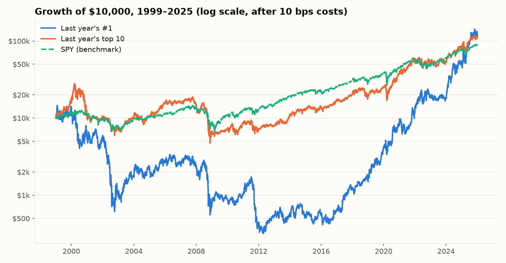
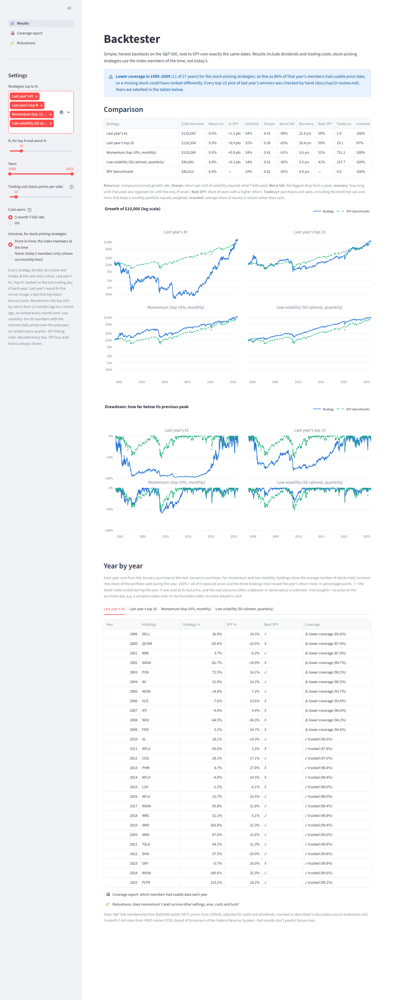
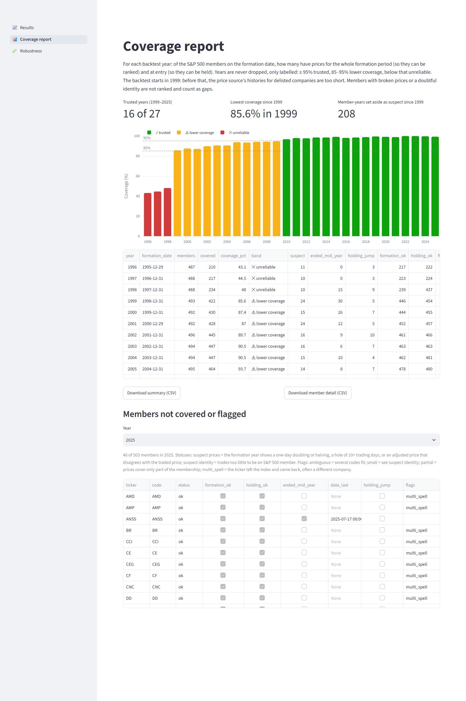

# Backtester

A Streamlit app that backtests simple, rule-based stock strategies on the S&P 500 and compares them with SPY. It's built honestly:
- **Point-in-time index membership:** the members of the time, not today's.
- **Total-return prices,** including dividends, and **prices for companies that no longer trade.**
- **Cash that earns T-bill rates.**
- **A hand-written backtest engine with no lookahead.**

**v1 asked:** what if, every January from 1999 to 2025, you had bought last year's best-performing S&P 500 stock?

| 1999–2025 | $10,000 becomes | Return per year | Worst fall | Sharpe |
|---|---|---|---|---|
| Last year's #1 | $115,600 | 9.5% | −98% | 0.41 |
| Last year's top 10 | $110,400 | 9.3% | −83% | 0.38 |
| SPY | $89,000 | 8.4% | −55% | 0.42 |

Chasing winners beat the index by about a point a year, but with far bigger crashes and a worse return per unit of risk. Done naively, on today's S&P 500 list, the same strategy appears to make **28% a year**: that's survivorship bias.

**v2 asks three more questions.**
- **Can a simple trend rule on SPY avoid the big crashes?** Partly. The **golden cross** (hold SPY while its 50-day average is above its 200-day average) matched SPY's 8.4% a year with a worst fall of −34% instead of −55%.
- **Do the research versions of stock-picking do better?** **Momentum** (the top 10% by return over the last year, skipping the latest month, re-ranked monthly) earned 9.3% a year, about what last year's top 10 did, with a worst fall of −61% instead of −83%. **Low volatility** (the 50 calmest members) earned 8.8% a year with a worst fall of −36%, and the best risk-adjusted return of the stock-pickers.
- **Does buying last year's *losers* work instead?** No. The mirror image of v1 returned 5.1% a year against SPY's 8.4%, despite rebound years of +135% (2003) and +78% (2009). Done naively, on today's members, it appears to return 28% a year: survivorship bias at its largest.

**Finally, is momentum real?** A [robustness check](docs/robustness.md) re-ran it with 36 different settings. 31 beat SPY over 1999–2025, so the idea isn't a fluke of one setting. But every one of them made its lead in 1999–2009, all but one trailed SPY since 2010, and none beats SPY by more than luck could explain.

**[Read the results →](docs/results.md)**



## The app
The app runs locally. Pick up to four strategies:
- last year's #1
- last year's top N
- last year's worst N (contrarian)
- momentum and low volatility
- three timing rules on SPY: the 200-day trend, the golden cross and RSI(2) dip-buying

You can also set N, the years, trading costs, what cash earns, and the universe. The app compares the strategies side by side with SPY: a comparison table, growth and drawdown charts, and a year-by-year table with every pick.



A Robustness page shows all 36 momentum variants side by side, and a coverage report shows, for each year, how many index members had usable price data.



## How it was checked
- **[Data sources](docs/data-source-evaluation.md):** why EODHD (Yahoo and others lack delisted stocks), and the traps found, such as tickers reused by other companies and broken price histories.
- **[Sanity check](docs/sanity-check.md):** built with the same data and engine, an equal-weight S&P 500 tracks RSP, the real equal-weight ETF, within about 0.4 points a year, and a low-volatility replica tracks SPLV within about 0.2. An audit of every day a strategy held a stock caught the price errors the automatic checks miss.
- **[Top-10 pick review](docs/top10-review.md):** all 270 picks for 1999–2025, checked against Yahoo or by hand.
- **[Worst-10 pick review](docs/worst10-review.md):** all 270 contrarian picks, plus hand verdicts on 26 crashes the price checks had set aside, because real crashes and broken data look alike.
- **Tests:** 141 tests, including hand-worked engine, metric, strategy and mapping cases and a no-lookahead proof for every strategy. Run `pytest`.

## Setup

Requires Python 3.11+.

```
python -m venv .venv
.venv\Scripts\activate          # Windows. On macOS/Linux: source .venv/bin/activate
pip install -r requirements.txt
copy .env.example .env          # then put your EODHD API key in .env
```

## Data

Price data is **not included** in this repo, because it is licensed for personal use only. Rebuild it locally with your own [EODHD](https://eodhd.com) API key (the Historian plan) in `.env`:

```
python scripts/build_data.py      # download (~4,500 calls, only what's missing), map, check, build universes
streamlit run app.py              # explore the results
```

Other scripts:
- `scripts/validate_prices.py` checks that the adjusted prices include dividends.
- `scripts/run_v1.py` and `scripts/review_top10.py` print the full v1 results and the pick review; `scripts/review_worst10.py` reviews the contrarian picks.
- `scripts/make_figures.py` redraws the charts and prints the numbers in the results.
- `scripts/sanity_rsp.py`, `scripts/sanity_factor_etfs.py` and `scripts/audit_holdings.py` (`--variants` adds the 36 momentum variants) run the sanity checks.
- `scripts/robustness.py` runs the 36 momentum variants for the Robustness page (several minutes).
- `scripts/screenshots.py` retakes the screenshots. It needs `pip install -r requirements-dev.txt` and `python -m playwright install chromium`.

Included in the repo:
- **Index membership:** `data/constituents.parquet` is derived from [fja05680/sp500](https://github.com/fja05680/sp500) under the MIT licence (notice in `data/LICENSE-fja05680.txt`).
- **T-bill rates:** `data/tbill_dtb3.csv` is FRED series [DTB3](https://fred.stlouisfed.org/series/DTB3), the 3-month Treasury bill rate (Board of Governors of the Federal Reserve System; public domain, citation requested).
- **Hand fixes to the data:** `data/ticker_map.csv` and `data/price_exclusions.csv`, each with a note explaining why.

## Licence

[MIT](LICENSE)
