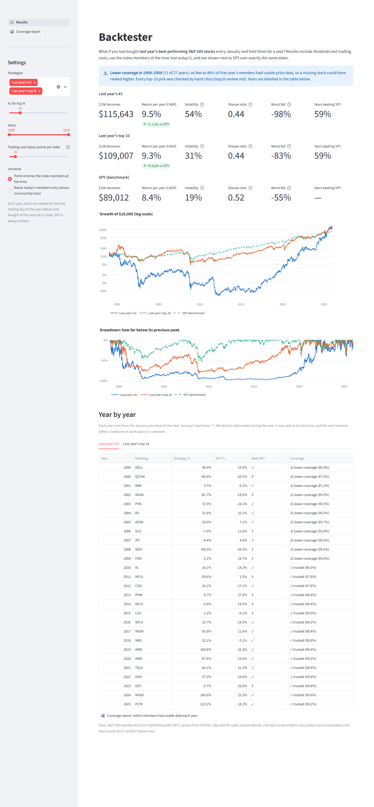

# Backtester

A Streamlit app that backtests simple, rule-based stock strategies on the S&P 500 and compares them with SPY. It's built honestly:
- **Point-in-time index membership:** the members of the time, not today's.
- **Total-return prices,** including dividends, and **prices for companies that no longer trade.**
- **A hand-written backtest engine with no lookahead.**

**The first question:** what if, every January from 1999 to 2025, you had bought last year's best-performing S&P 500 stock?

| 1999–2025 | $10,000 becomes | Return per year | Worst fall | Sharpe |
|---|---|---|---|---|
| Last year's #1 | $115,600 | 9.5% | −98% | 0.44 |
| Last year's top 10 | $109,000 | 9.3% | −83% | 0.44 |
| SPY | $89,000 | 8.4% | −55% | 0.52 |

Chasing winners beat the index by about a point a year, but with far bigger crashes and a worse return per unit of risk. Done naively, on today's S&P 500 list, the same strategy appears to make **28% a year**: that's survivorship bias. **[Read the results →](docs/results.md)**


## The app
The app runs locally. Choose strategies, N, years, trading costs and the universe; it shows the growth of $10k against SPY, drawdowns, metrics, and a year-by-year table with every pick.



A coverage report shows, for each year, how many index members had usable price data.


## How it was checked
- **[Data sources](docs/data-source-evaluation.md):** why EODHD (Yahoo and others lack delisted stocks), and the traps found, such as tickers reused by other companies and broken price histories.
- **[Sanity check](docs/sanity-check.md):** an equal-weight S&P 500 built with the same data and engine tracks RSP, the real equal-weight ETF, within about 0.5 points a year.
- **[Top-10 pick review](docs/top10-review.md):** all 270 picks for 1999–2025, checked against Yahoo or by hand.
- **Tests:** 80 tests, including hand-worked engine and metric cases and a no-lookahead proof. Run `pytest`.

## Setup

Requires Python 3.11+.

```
python -m venv .venv
.venv\Scripts\activate          # Windows. On macOS/Linux: source .venv/bin/activate
pip install -r requirements.txt
copy .env.example .env          # then put your EODHD API key in .env
```

## Data

Price data is **not included** in this repo, because it is licensed for personal use only. Rebuild it locally with your own [EODHD](https://eodhd.com) API key (the Historian plan) in `.env`:

```
python scripts/build_data.py      # download (~4,500 calls, only what's missing), map, check, build universes
streamlit run app.py              # explore the results
```

Other scripts:
- `scripts/validate_prices.py` checks that the adjusted prices include dividends.
- `scripts/run_v1.py` and `scripts/review_top10.py` print the full results and the pick review.
- `scripts/make_figures.py` redraws the charts above.
- `scripts/screenshots.py` retakes the screenshots. It needs `pip install -r requirements-dev.txt` and `python -m playwright install chromium`.

Index membership **is included**: `data/constituents.parquet` is derived from [fja05680/sp500](https://github.com/fja05680/sp500) under the MIT licence (notice in `data/LICENSE-fja05680.txt`). Hand fixes to the data are in `data/ticker_map.csv` and `data/price_exclusions.csv`, each with a note explaining why.

## Licence

[MIT](LICENSE)
