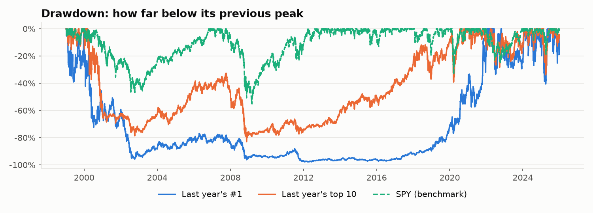
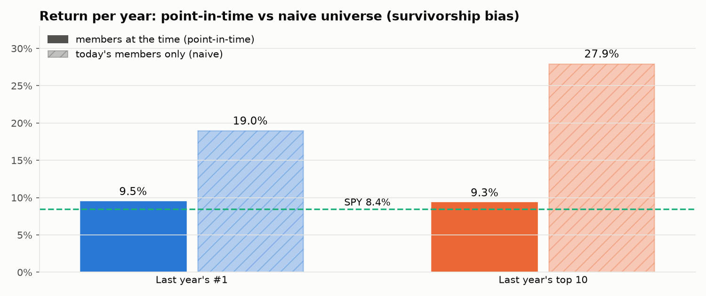
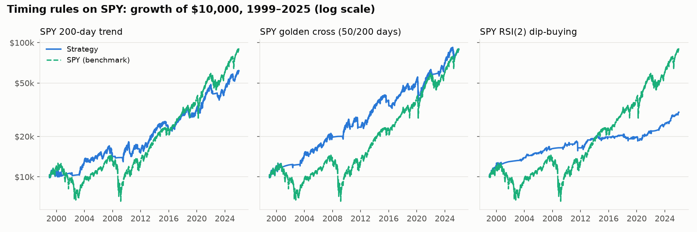

# Results: buying last year's winners

**The question:** what if, every January from 1999 to 2025, you had bought the S&P 500's best-performing stock of the year before (or its top 10) and held it for a year?

**The short answer:** chasing last year's winners beat the S&P 500 by about one percentage point a year, but with nearly three times the volatility and crashes of up to 98%. Measured by return per unit of risk, it did *worse* than simply holding the index.

**v2 asks a different question:** can a simple trend rule on SPY avoid the big crashes? Partly. The golden cross matched the market's return with a worst fall of −34% instead of −55% ([details](#v2-timing-rules-on-spy)).

## The numbers (1999–2025, 10 bps per trade, dividends reinvested)

Uninvested cash earns the 3-month T-bill rate, and the Sharpe ratio measures return per unit of volatility *beyond* what T-bills paid.

| Strategy | $10,000 becomes | Return per year | Volatility | Worst fall | Recovery took | Sharpe | Years beating SPY |
|---|---|---|---|---|---|---|---|
| Last year's #1 | $115,600 | 9.5% | 54% | −98% | about 23 years | 0.41 | 59% |
| Last year's top 10 | $111,000 | 9.3% | 31% | −83% | about 20 years | 0.38 | 59% |
| **SPY (S&P 500)** | **$89,000** | **8.4%** | **19%** | **−55%** | about 5 years | **0.42** | — |

## What happened
- **The dot-com bust (2000–2002) nearly wiped the strategy out.** The 1999 winners were the bubble's stars: Qualcomm had risen 2,619%. Buying it in January 2000 lost 61% that year. Two years later, 2001's winner Nvidia lost 82% in 2002. By the end of 2002, $10,000 put into "last year's #1" was worth under $1,000 ($957).
- **2008 and 2011 hit again.** National Oilwell Varco, 2007's winner, fell 65% in 2008. Netflix, 2010's winner, fell 60% in 2011. The low point came in April 2012, when the $10,000 was worth $321.
- **The comeback came from the 2017–2025 tech surge.** The picks included Nvidia (+96% in 2017, +187% in 2024), AMD (+161% in 2019) and Palantir (+123% in 2025). The strategy only got ahead of SPY for good in April 2025.
- **Momentum works until it doesn't.** Last year's best stock is often in a bubble or a one-off boom, and the bill arrives the next year. Ten picks instead of one smooth this out a lot (31% volatility instead of 54%), but don't change the return much.

## Survivorship bias: the same strategy, done naively

A common shortcut is to backtest on *today's* S&P 500 list. Run that way, the same rules return **19.0% a year (top 1) and 27.9% a year (top 10)**, turning $10,000 into $1.1 million or $7.7 million.
- **Why it's wrong:** today's list only contains companies that survived and did well enough to be in the index now. The naive version can never buy a 1999 winner that later collapsed or was taken over.
- **Lookahead too:** it ranks companies like Axon (Taser) in 2003, two decades before they joined the index.
- **The scale of it:** about 10–19 percentage points a year of the naive result is bias, not skill. Avoiding this needed point-in-time membership data and prices for delisted stocks; see [data sources](data-source-evaluation.md).

## Costs
The strategy trades about twice a year (sell last year's picks, buy this year's), so costs matter little. Last year's #1 returns 9.7% a year with no costs, 9.5% at 10 bps per trade and 8.7% at 50 bps.

## v2: timing rules on SPY

A different idea: always own the market (SPY), but step aside into T-bills when a simple signal says the trend has turned. Each rule decides at the close and trades at the next day's close.

| Rule | Holds SPY when… | $10,000 becomes | Return per year | Volatility | Worst fall | Sharpe | Trades per year | Invested |
|---|---|---|---|---|---|---|---|---|
| 200-day trend | SPY closes above its 200-day average | $61,400 | 7.0% | 12% | −24% | 0.47 | 6.7 | 75% |
| Golden cross | the 50-day average is above the 200-day average | $88,900 | 8.4% | 14% | −34% | **0.52** | 1.0 | 74% |
| RSI(2) dip-buying | a sharp two-day dip in an uptrend, until it bounces | $30,400 | 4.2% | 6% | −15% | 0.37 | 15 | 10% |
| **SPY (S&P 500)** | always | **$89,000** | **8.4%** | **19%** | **−55%** | **0.42** | — | 100% |

- **The golden cross matched SPY's return with much smaller crashes.** It got the same 8.4% a year, but its worst fall was −34% against −55%, and it had the best Sharpe ratio of anything tested. It traded about once a year. It led SPY for twenty years by stepping aside in the slow bear markets of 2000–02 and 2008. It then gave that lead back in 2020: the COVID crash and rebound were too fast, so it sold after the drop and bought back late.
- **The 200-day rule cut the worst fall to −24%,** but it lost about 1.5 points a year to SPY. It flips often (6.7 trades a year), and many of those flips are false alarms that sell low and buy back higher.
- **RSI(2) dip-buying was mostly in T-bills** (invested 10% of the time) and returned 4.2% a year. Published versions buy at the close of the signal day. This backtest trades the next day, to avoid lookahead, and for a strategy that holds for only a few days that delay costs a lot. Its edge also faded after about 2012.
- **What cash earns matters for timing rules.** With cash at 0% instead of T-bill rates, they return 0.5–1.8 points a year less (6.4%, 7.9% and 2.4%). That's why cash earns the T-bill rate by default.
- **The pattern:** trend rules don't make more money than the market, but they can make the ride far less frightening, and they help most in slow, grinding bear markets (2000–02, 2008). A fast crash with a fast recovery, like 2020's, is their weak spot.

## How much to trust this
- **The ranking misses some stocks in early years.** For 1999–2009, 86–95% of each year's members had usable price data; from 2010 it's 97–100% (see the coverage report). A stock missing from the data could have been the real #1. To guard against that, **all 270 top-10 picks were checked**, against Yahoo or by hand ([review](top10-review.md)).
- **The data source has broken price histories.** Examples are splits counted twice, prices that continue as another company after a takeover, and corrupt dividend adjustments. Automatic checks keep suspect stocks out of the ranking, and hand fixes cover the rest. Prices were never edited by hand ([details](data-source-evaluation.md)).
- **The data and engine reproduce a real index.** An equal-weight S&P 500 built the same way tracks the real equal-weight ETF (RSP) within about 0.5 points a year ([sanity check](sanity-check.md)).
- **Cash earns the 3-month T-bill rate** (FRED series DTB3), accrued daily at the previous day's rate.
- **Some things aren't modelled:**
  - **Taxes,** which would hurt a strategy that sells everything every year, and timing rules that trade often.
  - **Trading frictions beyond the flat 10 bps.**
  - **What really happened to stocks whose data ended while held.** They're sold at their last price and flagged.
- **This is history, not a forecast.** The result depends heavily on a few huge winners in the last decade.

## Reproduce
With your own [EODHD](https://eodhd.com) API key (the Historian plan): `python scripts/build_data.py`, then `python scripts/make_figures.py` for these charts and numbers, or `streamlit run app.py` to explore other settings. See the [README](../README.md).
