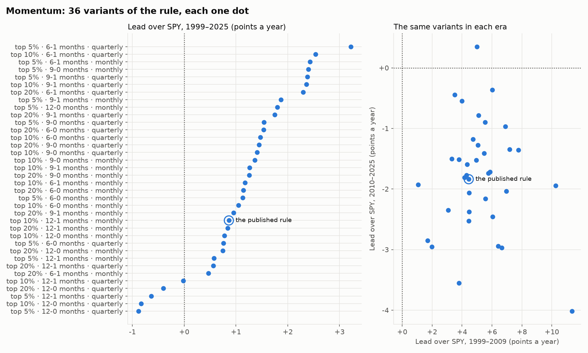

# Robustness: is momentum real? (M6)

**Verdict: mixed.** Momentum's lead over SPY holds up across settings, but not across time.
- **Across settings:** 31 of 36 variants of the rule beat SPY over 1999–2025, typically by 1.2 points a year.
- **Across time:** all 36 beat SPY in 1999–2009 (typically by 5.0 points a year), but only 1 did in 2010–2025 (typically 1.8 points behind).
- **Luck:** no variant passes the luck test.

The criteria fixed before running call that "mixed", because it fails the condition that a majority beat SPY in each era.

Reproduce: `python scripts/robustness.py` (several minutes), then open the app's Robustness page or run `python scripts/make_figures.py` for the figure.

## Why this check
The momentum rule in the results (the top 10% of members by return from 12 months ago to 1 month ago, re-ranked monthly) beat SPY by about a point a year. But that rule involves several fairly arbitrary choices. If the lead only appeared with exactly those choices, it would probably be a fluke of history: "curve fitting". If most reasonable variants show a similar lead, the idea is more likely real.

**Ground rule:** all variants are judged together, and the best one is never the headline. Trying many settings and keeping the best mostly finds the luckiest one (data snooping), whose backtest overstates what it would do next.

## The test, fixed before any results were seen

| Setting | Values |
|---|---|
| Share of members held | top 5%, 10%, 20% |
| Lookback | 6, 9, 12 months |
| Skip the latest month | yes, no |
| Rebalance | monthly, quarterly |

That gives 3 × 3 × 2 × 2 = 36 variants. Everything else is held fixed: members of the time, equal weight, 10 bps per trade, cash at the T-bill rate, 1999–2025. Every variant ranks from the same month-end universe (members with 12 clean months of prices).

**Verdict criteria:**
- **Robust:** at least 75% of variants beat SPY over 1999–2025, *and* a majority beat it in each era (1999–2009, 2010–2025).
- **Fragile:** fewer than half beat SPY.
- **Mixed:** anything in between.

**For each variant:** return and lead over SPY, the lead in each era, Sharpe ratio, worst fall, turnover, the **break-even cost** (the trading cost at which the lead disappears), and two luck measures:
- the **t-statistic**: the average yearly lead divided by its uncertainty (around 2 or more is the usual bar for "probably not luck");
- **no lead when resampled**: the 27 yearly leads redrawn at random 20,000 times, and how often the average comes out at zero or below.

## Results

| 36 variants | Result |
|---|---|
| Beat SPY over 1999–2025 | **31** (86%); typical lead +1.2 points a year, range −0.9 to +3.2 |
| Beat SPY in 1999–2009 | **36** (100%); typical lead +5.0 points a year |
| Beat SPY in 2010–2025 | **1** (3%); typical lead −1.8 points a year, range −4.0 to +0.3 |
| Pass the luck test (t ≥ 2) | **0**; highest t 1.81, typical 0.78 |
| No lead when resampled | typically 22% of resampled histories |
| Break-even trading cost | typically 24 bps (range 0–59) |
| Sharpe ratio | typically 0.44 (range 0.33–0.50), against SPY's 0.42 |
| Worst fall | −54% to −71%, against SPY's −55% |

- **The idea isn't a fluke of one setting.** Almost every variant beat SPY over the whole period, and the published rule (+0.9 points a year) ranks 24th of 36: a typical variant, not a lucky pick. Shorter lookbacks did somewhat better than 12 months (typical leads +1.3 and +1.5 points for 6 and 9 months, +0.6 for 12), quarterly rebalancing slightly better than monthly (+1.5 against +1.1), and skipping the latest month made no difference (+1.2 either way). These differences are themselves within the noise, so they are no reason to switch to the "best" settings.
- **But the edge belongs to one era.** Every variant was ahead of SPY in 1999–2009, by 1 to 11 points a year. In 2010–2025 all but one trailed it, by up to 4 points a year. Momentum's weak run since 2009 is widely noted. It began with the "momentum crash" of 2009 (the beaten-down stocks rebounded fastest), and in a market led by a few giant companies, an equal-weight portfolio of about 50 stocks owns too little of them.
- **Nothing passes the luck test.** The yearly lead swings by around 12 points from year to year, so a lead of one or two points a year can't be told apart from luck in 27 years. With 36 variants tested, one or two crossing t ≈ 2 by chance alone would have been no surprise; none did.
- **Costs matter.** Monthly variants replace about four times their holdings a year (median turnover 421%) and break even at about 22 bps per trade; quarterly ones (229%) at about 38 bps. Trading large US stocks costs a few bps today, but the bid-ask spread alone was often 20 bps or more before 2001.
- **The ride is rougher, not smoother.** Typical Sharpe ratios are a little above SPY's (0.44 against 0.42), but 30 of 36 variants had a deeper worst fall than SPY.

## Data fixes found on the way
Running 36 variants means holding many more stocks at many more moments. The holdings audit (`scripts/audit_holdings.py --variants`) now covers all of them, and it found broken data that none of the published strategies had held on the bad days:
- **R.R. Donnelley** sits at about $0.02 a share until December 2001, then jumps 44,281% in a day (the company really traded around $30). Before the fix, one variant (top 20%, 12-0 months, monthly) held it across the jump and showed a fake +469% year: 16.7% a year instead of 9.2%.
- **Splits applied twice:** Gateway (1999), Liz Claiborne (2002), St. Jude Medical (2004, a second case after 2002). Raytheon's corrupt adjustment (2001).
- **Spin-offs missing from the adjusted prices:** Kansas City Southern (Stilwell Financial, 2000), E.W. Scripps (Scripps Networks, 2008), Questar (QEP Resources, 2010).
- **Wrong scale or junk:** Electronic Arts before its 2003 split, Noble Energy's 2013 split and its post-takeover prices in 2020, and Schering-Plough from January 2008.

All are excluded by date in `data/price_exclusions.csv`, never edited. Two published results moved slightly:
- **momentum:** 9.2% → 9.3% a year, because a few members dropped out of its ranking at some month-ends;
- **low volatility:** 8.7% → 8.8% a year, because it had held R.R. Donnelley's junk prices for two quarters.

## What this means
Momentum among S&P 500 stocks isn't an artefact of one lucky setting: nearly every reasonable version beat the index over 27 years. But that lead came from 1999–2009. Since 2010, almost every version has trailed a simple index fund, and over the whole period none beats SPY by more than luck could explain. A sensible conclusion: momentum is a real tendency that has paid off in some eras and not others, and holding SPY would have done about as well with far less work, trading and tax.
